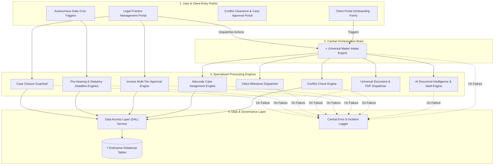

# Enterprise Legal Practice Management & Case Intake Engine

A modular, event-driven workflow automation platform built with **n8n**, orchestrating end-to-end client onboarding, AI document triage, conflict checking, case assignment, multi-tier approvals, and statutory deadline tracking for legal practices.

-red)

---

## Architecture Overview

The system follows a **decoupled, microservices-style orchestrator architecture**. Instead of maintaining brittle, monolithic automations, business logic is divided into 15 specialized reusable engines coordinated by a central orchestrator.

---

## The 15 Specialized Engines

| # | Engine Name | Type | Key Responsibilities |
|---|---|---|---|
| **1** | **Legal Practice Management Portal & Central Orchestrator** | Portal / Master | 76-node unified interface for case reviews, advocate updates, and invoice actions. |
| **2** | **Universal Matter Intake Engine (Reusable)** | Orchestrator | Core brain; assigns `case_id`, runs conflict checks, and coordinates downstream services. |
| **3** | **Client Portal — Onboarding & Dashboard** | Webhook / Form | Public client interface for new case registration, document uploads, and case tracking. |
| **4** | **Conflict Check Engine (Reusable)** | Logic Engine | Scans active and historical case records to identify adverse parties and conflicts of interest. |
| **5** | **Conflict Clearance & Case Approval Portal** | Review Portal | Internal portal for managing partners to approve, flag, or decline disputed cases. |
| **6** | **AI Document Intelligence & Vault Engine** | AI / LLM | Integrates OpenRouter models to extract structured entities and summaries from legal PDFs. |
| **7** | **Advocate Case Assignment & Intake Review Engine** | Workflow Engine | Automatically matches qualified advocates to approved matters and dispatches assignment briefs. |
| **8** | **Universal Document & PDF Dispatcher (Reusable)** | Document Gen | Populates dynamic Google Docs templates and exports branded engagement letters and invoices to Google Drive. |
| **9** | **Client Milestone Dispatcher (Reusable)** | Notification | Manages automated client email updates across onboarding, discovery, and trial stages. |
| **10** | **Invoice Multi-Tier Approval Engine (Reusable)** | Approval Gate | Evaluates billing amounts against automated threshold rules with multi-tier managerial sign-offs. |
| **11** | **Statutory Deadline Tracking & Reminder Engine** | Scheduled / Cron | Daily monitor tracking court limitation periods and dispatching escalation notices. |
| **12** | **Pre-Hearing Preparation & Client Reminder Engine** | Scheduled / Cron | Daily monitor alerting lawyers and clients to upcoming trial sessions and action checklists. |
| **13** | **Case Closure Guardrail (Reusable)** | Security Gate | Prevents premature closure of active matters with unbilled invoices or pending hearings. |
| **14** | **Data Access Layer (DAL) Service (Reusable)** | Data Layer | Centralized CRUD service decoupling workflow logic from physical database storage. |
| **15** | **Central Error & Incident Logger (Reusable)** | Reliability | Global error handler configured via `errorWorkflow` to intercept and log all unhandled failures. |

---

## Enterprise Resilience & Fault Tolerance

1. **Global Unhandled Error Interception:**
   Every workflow specifies `"settings": { "errorWorkflow": "Dvao8HFN2GnGuaQZ" }`. If an external API (e.g., OpenRouter, Gmail) times out, the `Central Error & Incident Logger` captures the execution payload, failed node name, and stack trace, persisting it to `system_error_logs`.

2. **Idempotency & Duplicate Guards:**
   The `Client Portal` checks for duplicate filings (matching phone, email, and party identities) before executing downstream tasks, preventing duplicate case records and wasted LLM token spend.

3. **Role-Based Access Control (RBAC):**
   Integrated with `permission_matrix` to restrict sensitive administrative actions (e.g., case closure waivers, invoice approvals) to authorized user roles.

---

## Relational Data Architecture

The platform operates against 7 structured relational tables (schemas located in `/data_tables/`):

* `case_directory.csv` (26 columns): Master case registry, assigned advocate, opponent, hearing date, and Vault links.
* `workflow_history.csv` (13 columns): Immutable audit log of all decisions, thresholds, and state transitions.
* `statutory_deadlines.csv` (6 columns): Court deadlines, limitation periods, and alert intervals.
* `system_error_logs.csv` (6 columns): Incident logging table capturing execution errors and failure diagnostics.
* `workflow_settings.csv` (4 columns): Dynamic system thresholds (e.g., `AUTO_APPROVE_THRESHOLD = 5000`).
* `permission_matrix.csv` (5 columns): Authorization matrix for client, advocate, and administrative roles.
* `case_closure_history.csv` (4 columns): Formal records of closed cases and administrative waivers.

---

## Technology Stack

* **Orchestration:** n8n (Self-Hosted / Enterprise)
* **AI & LLM Services:** OpenRouter API (`openai/gpt-4o-mini`, `anthropic/claude-3.5-haiku`)
* **Workspace Integrations:**
  * **Gmail API:** Automated transactional alerts & milestone dispatches
  * **Google Drive API:** Encrypted legal vault storage & PDF generation
  * **Google Docs API:** Dynamic placeholder population (`{{client_name}}`, `{{fee}}`)
* **Security:** OAuth 2.0 Client credentials, environmental secret isolation, and isolated error workflows.

---

## License & Ownership
Engineered by **Cloud-Company13**. Built for modular enterprise deployment.
